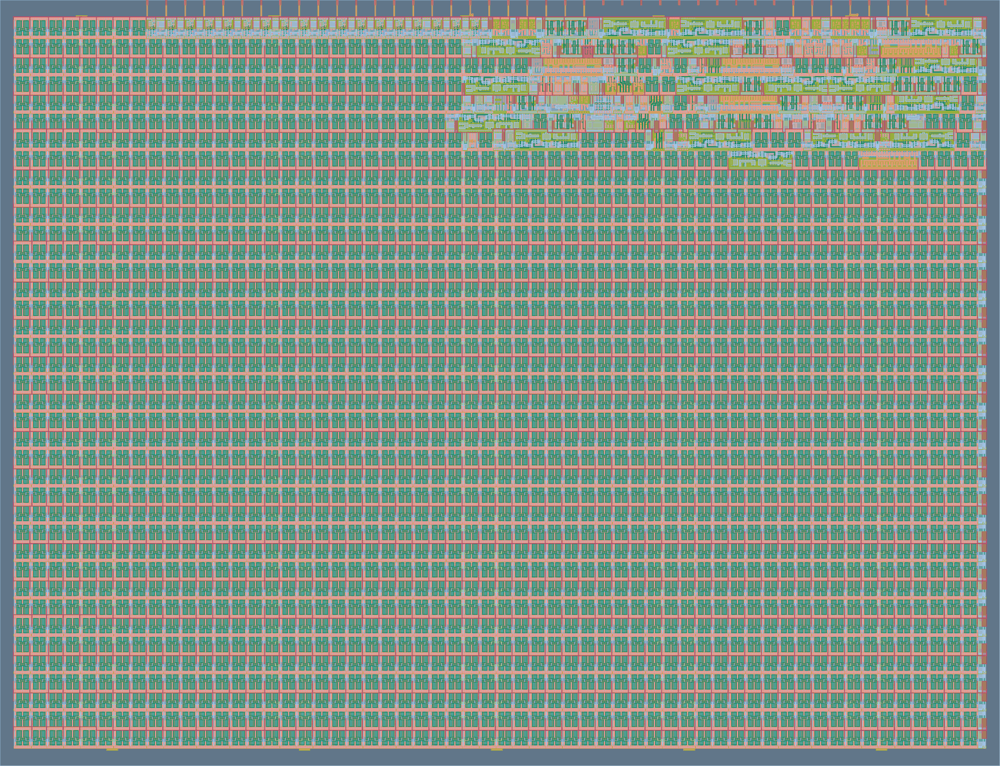
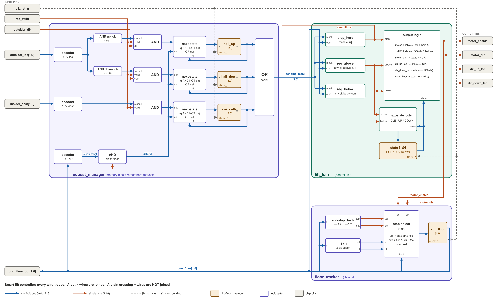
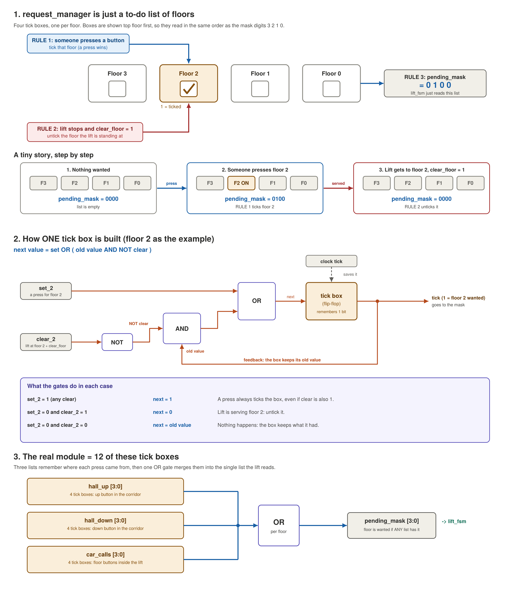

# Smart Lift Controller ASIC

[](../../actions/workflows/gds.yaml)
[](../../actions/workflows/docs.yaml)
[](../../actions/workflows/test.yaml)

A 4-floor directional collective elevator controller ASIC designed in Verilog and targeted for fabrication via **Tiny Tapeout** on the **IHP SG13G2 (130nm BiCMOS)** process.

---

## 3D Silicon & Layout Preview

Interactive 3D view of the physical layout:
- **[Launch 3D Online Viewer](https://gds-viewer.tinytapeout.com/?pdk=ihp-sg13g2&model=https://raw.githubusercontent.com/Pranso141/ttihp-verilog-template/main/docs/gds/tinytapeout.oas)**

<p align="center">
  
  <br>
  <em>Physical GDS Layout (IHP SG13G2 Standard Cell ASIC)</em>
</p>

Layout files are archived directly in [`docs/gds/`](docs/gds/):
- GDSII Layout: [`docs/gds/tt_um_lift.gds`](docs/gds/tt_um_lift.gds)
- OASIS Layout: [`docs/gds/tt_um_lift.oas`](docs/gds/tt_um_lift.oas)
- LEF Macro: [`docs/gds/tt_um_lift.lef`](docs/gds/tt_um_lift.lef)

---

## Hardware Video Demonstration

A full screencast recording showcasing the design and simulation:

<p align="center">
  <video src="docs/assets/smart_lift_demo.webm" width="680" controls>
    Your browser does not support video playback. You can download the screencast directly: <a href="docs/assets/smart_lift_demo.webm">docs/assets/smart_lift_demo.webm</a>.
  </video>
</p>

*Video file: [`docs/assets/smart_lift_demo.webm`](docs/assets/smart_lift_demo.webm)*

---

## Architectural Overview

The smart lift controller uses a **Directional Collective Architecture** implemented as three cleanly partitioned submodules to decouple memory latching, datapath counting, and control logic:

```
                  +-----------------------------------------------------------+
                  |                      tt_um_lift                           |
                  |                                                           |
ui_in[1:0] (loc)  |    +-------------------+                                  |
ui_in[4]   (dir)  |--->|                   | pending_mask[3:0]                |
ui_in[3:2] (dest) |--->|  request_manager  |----------------+                 |
ui_in[5]   (req)  |--->|   (Memory Block)  |                |                 |
                  |    +-------------------+                v                 |
                  |              ^ clear_floor     +------------------+       |
                  |              |                 |     lift_fsm     |------>| uo_out[0] (motor_en)
                  |              +-----------------|   (Control Unit) |--->| uo_out[1] (motor_dir)
                  |                                +------------------+   |--->| uo_out[4] (dir_up)
                  |                                  | motor_en/dir       |--->| uo_out[5] (dir_down)
                  |                                  v                        |
                  |    +-------------------+    +-----------------+           |
                  |    |   floor_tracker   |<---|  Floor Counter  |---------->| uo_out[3:2] (floor)
                  |    |    (Datapath)     |    +-----------------+           |
                  |    +-------------------+                                  |
                  +-----------------------------------------------------------+
```

### Complete Circuit Wiring & Gate Architecture
Detailed structural connectivity of every register, mux, and gate in the design:

<p align="center">
  
  <br>
  <em>Tri-module structural schematic with all bus widths, gates, and flip-flops</em>
</p>

---

## Submodule Architecture

### 1. `request_manager.v` (Memory Block)
- **Registers**: Latches hall calls (`hall_up[3:0]`, `hall_down[3:0]`) and car calls (`car_calls[3:0]`).
- **Input Strobe**: `req_valid` pulses prevent phantom calls from resting low input states.
- **Physical Boundary Guards**: Eliminates impossible calls (such as Down on floor 0 or Up on floor 3).
- **Clear Logic**: Generates `pending_mask = hall_up | hall_down | car_calls` and synchronously clears serviced floors via `clear_floor`.

<p align="center">
  
</p>

### 2. `lift_fsm.v` (Control Unit)
- **State Machine**: 3 states (`IDLE`, `UP`, `DOWN`).
- **Parallel Combinational Lookahead**:
  - `stop_here`: checks if requests exist on the current floor.
  - `req_above`: checks if pending calls exist at higher floors.
  - `req_below`: checks if pending calls exist at lower floors.
- **Directional Sweep**: Serves requests in the current travel direction before reversing, avoiding unnecessary directional oscillation.

### 3. `floor_tracker.v` (Datapath)
- Isolated synchronous counter tracking `currentFloor[1:0]` (floors 0 to 3).
- Advances one floor per clock cycle when `motor_enable` is active.
- Saturates cleanly at floor 0 and floor 3 to prevent overflow/underflow.

---

## Pinout Specification

| Pin | Direction | Signal Name | Description |
|---|---|---|---|
| `ui_in[1:0]` | Input | `outsider_loc[1:0]` | Floor location for exterior hall call (0 to 3) |
| `ui_in[3:2]` | Input | `insider_dest[1:0]` | Destination floor selected inside cabin (0 to 3) |
| `ui_in[4]` | Input | `outsider_dir` | Exterior hall call direction (`1` = Up, `0` = Down) |
| `ui_in[5]` | Input | `req_valid` | Request strobe pulse (high for 1 clock cycle to register) |
| `ui_in[7:6]` | Input | `unused` | Tied low / unused |
| `uo_out[0]` | Output | `motor_enable` | Motor driver active flag (`1` = moving, `0` = stopped) |
| `uo_out[1]` | Output | `motor_dir` | Motor direction (`1` = Up, `0` = Down) |
| `uo_out[3:2]` | Output | `curr_floor_out[1:0]` | Current cabin floor index (`00` to `11`) |
| `uo_out[4]` | Output | `dir_up_led` | Up movement indicator LED |
| `uo_out[5]` | Output | `dir_down_led` | Down movement indicator LED |
| `uo_out[7:6]` | Output | `unused` | Tied to `2'b00` |
| `clk` | Input | `clk` | Clock input (nominal 20 MHz) |
| `rst_n` | Input | `rst_n` | Active-low asynchronous reset |

---

## Synthesis & ASIC Metrics (IHP SG13G2)

- **Technology**: IHP SG13G2 130nm BiCMOS (7 metal layers)
- **Die Allocation**: 1x1 Tiny Tapeout tile (~167 µm × 108 µm)
- **Cell Count**: 110 standard cells
- **Sequential Cell Count**: 17 D-type flip-flops (`sg13g2_dfrbpq_1`)
- **Total Standard Cell Area**: ~1,605.63 µm² (~51.87% sequential)

---

## Guides & Documentation

Comprehensive design journey and step-by-step build documentation are included in [`docs/guide/`](docs/guide/):

1. **[Step-by-Step Build Guide (DOCX)](docs/guide/Smart_Lift_Controller_Step_by_Step_Build_Guide.docx)**:
   Detailed reference guide containing code structure, design decisions, verification scenarios, debug checklist, and formal invariants.
2. **[RTL Design Journey (PDF)](docs/guide/Smart_Lift_Controller_RTL_Design_Journey.pdf)**:
   Explains architectural design shifts, pinout optimization for hardware boundaries, and FSM lookahead optimization.
3. **[Project Datasheet Markdown](docs/info.md)**:
   Tiny Tapeout documentation rendered during the automated docs build.

---

## 3D Conversion Tool (`gds2gltf`)

To convert the GDSII file to 3D glTF locally:
```bash
# Install dependencies
pip install numpy gdspy triangle pygltflib

# Run conversion
python3 tools/gds2gltf.py docs/gds/tt_um_lift.gds
```
The script generates `tt_um_lift.gds.gltf` ready for import into Blender or WebGL 3D viewers.

---

## Verification & Simulation

The testbench runs with **Icarus Verilog** and **cocotb**:

```bash
cd test
make clean
make
```

To run gate-level simulation against the hardened netlist:
```bash
make clean
make GATES=yes
```

---

## License

This project is licensed under the Apache 2.0 License - see the [LICENSE](LICENSE) file for details.
